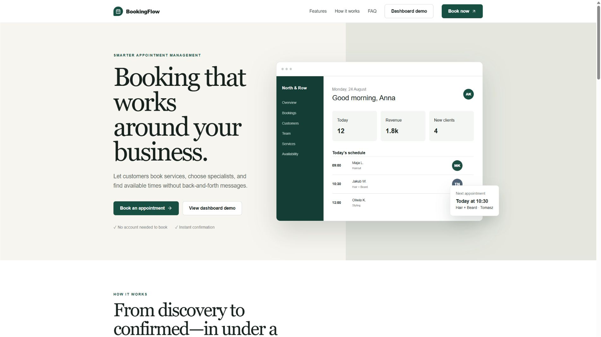
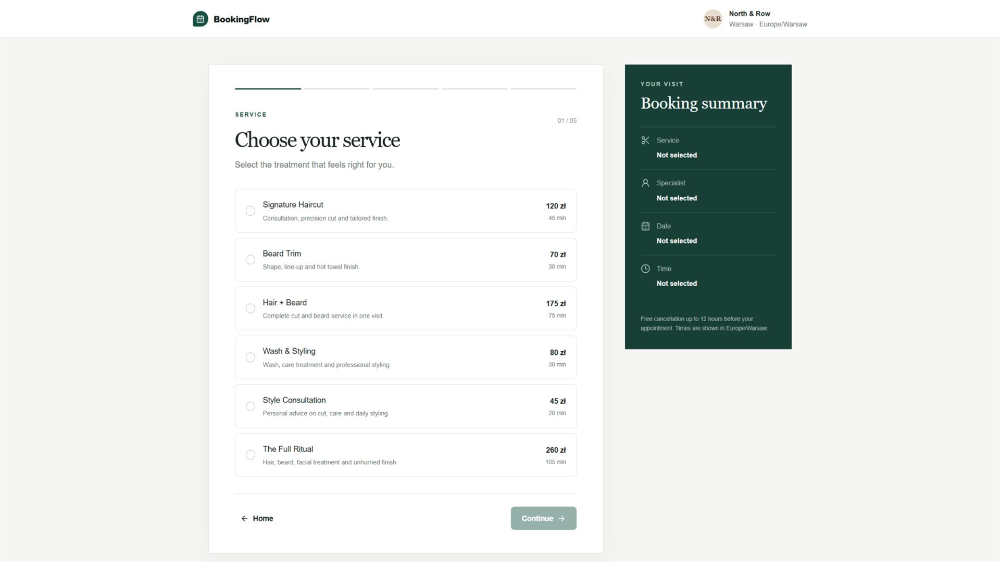
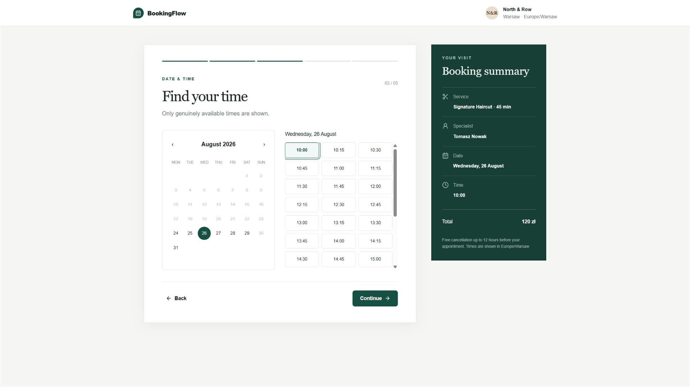
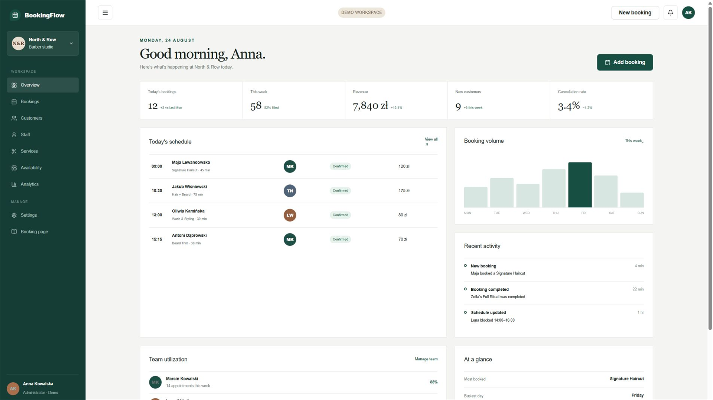
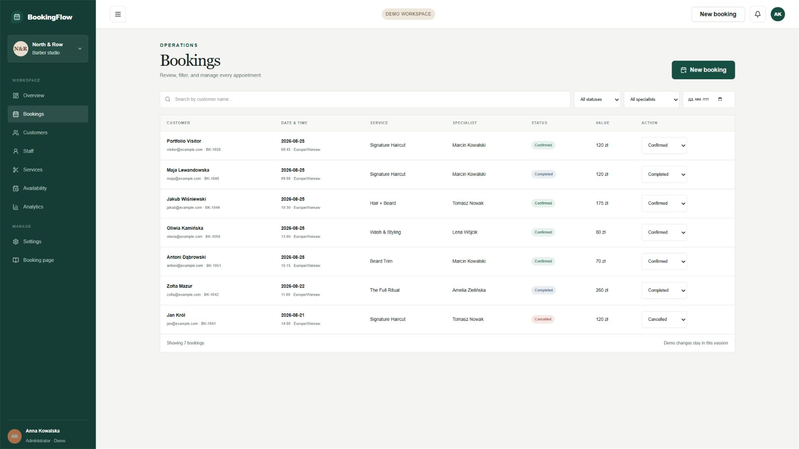
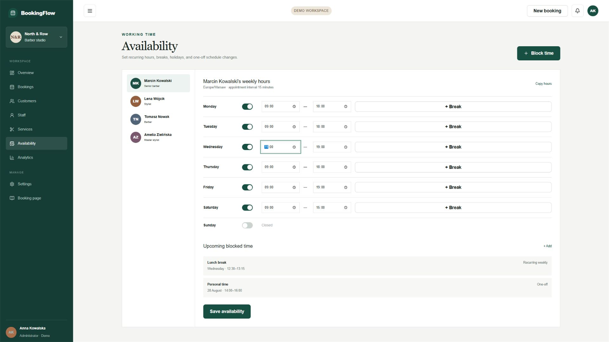
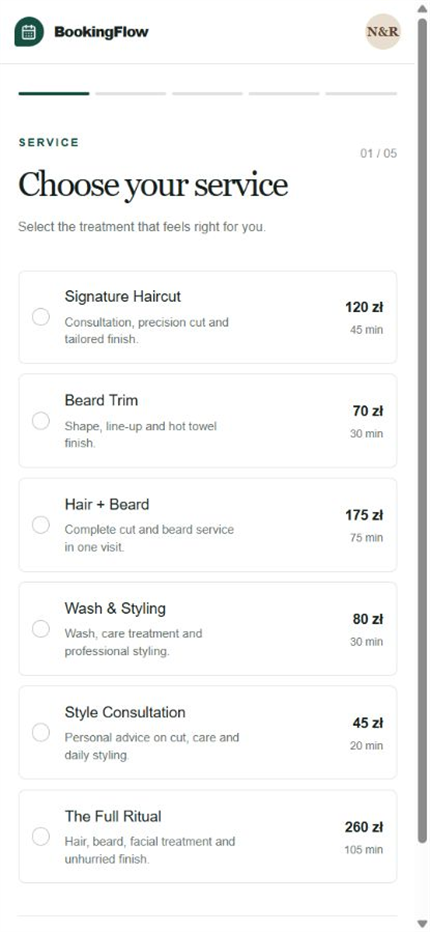
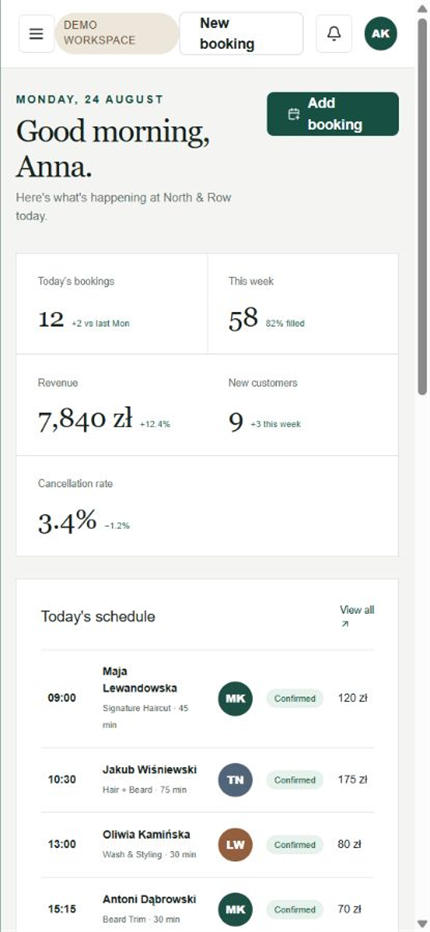

<<<<<<< HEAD
# BookingFlow

BookingFlow is a full-stack appointment scheduling application for service businesses, with real-time availability, customer booking, staff scheduling, and admin management.

The included demo workspace represents North & Row, a Warsaw barber studio. It is designed to run locally without external accounts while retaining a production Supabase path.

## Features

- Five-step customer booking flow with service, specialist, date, time, and confirmation
- Server-calculated availability based on working hours, duration, bookings, breaks, and blocked time
- Customer area for upcoming, completed, and cancelled bookings
- Booking administration with search, filters, manual creation, and status updates
- Service, staff, customer, schedule, analytics, and workspace management
- Supabase authentication flows for sign-in, sign-up, and password reset
- PostgreSQL schema, transaction function, indexes, and row-level security
- Responsive customer and admin interfaces
- Zod validation and tested authorization rules
- Notification provider interface with a local console implementation

## Screenshots



| Customer booking | Live availability |
| --- | --- |
|  |  |

| Admin overview | Booking management |
| --- | --- |
|  |  |

| Schedule management | Mobile booking |
| --- | --- |
|  |  |



## Tech Stack

- Next.js 16 and React 19
- TypeScript
- Tailwind CSS 4
- Supabase and PostgreSQL
- Supabase Auth
- Zod
- date-fns
- Lucide React
- Vitest

## Architecture

The App Router separates public pages, customer views, admin views, and server endpoints. Shared domain modules contain types, seeded demo records, validation, authorization rules, and deterministic availability calculations. The booking endpoint validates every request and rechecks the selected slot before confirming it.

Without Supabase environment variables, the app uses a clearly labeled in-memory server store plus browser-local presentation state. With Supabase configured, the included clients and SQL migration provide the production data and authentication foundation.

## Database

The migration in `supabase/migrations` creates businesses, profiles, services, staff, staff-to-service assignments, weekly availability rules, blocked periods, and bookings. Foreign keys preserve relationships, indexes support common scheduling queries, and row-level security limits customers to their own records while granting business management to administrators.

Run `supabase/seed.sql` after the migration to create the North & Row business, services, staff, assignments, and weekly hours.

## Availability Engine

Availability starts with a specialist's working window for the selected weekday. It advances in configurable intervals and removes any candidate whose full service duration overlaps a confirmed booking or blocked period. Closed weekdays return no slots. The calculation is deterministic and runs on the server before results reach the booking screen.

All database timestamps use `timestamptz` and should be written as UTC. The business timezone defaults to `Europe/Warsaw`; dates and times shown to customers are interpreted in that timezone.

## Double Booking Protection

The application performs two layers of protection:

1. The server recalculates availability immediately before accepting a booking.
2. PostgreSQL applies a GiST exclusion constraint to the specialist and appointment time range for confirmed bookings.

The `create_booking` database function calculates the end time from the stored service duration and converts an exclusion conflict into a clear unavailable-slot response. Concurrent requests for the same specialist and overlapping time cannot both succeed.

## Authentication

The authentication page supports Supabase email sign-in, sign-up, and password reset. When Supabase variables are configured, the server proxy protects customer and admin routes, refreshes session cookies, and verifies the administrator role before allowing access to the business dashboard. When those variables are absent, protected pages remain available only as clearly labeled portfolio demo views backed by seeded presentation data.

## Getting Started

Requirements: Node.js 20 or newer and npm.

```bash
npm install
npm run dev
```

Open `http://localhost:3000`. Use `/auth` for authentication or choose a labeled demo role to explore the app without external configuration.

## Environment Variables

Create `.env.local` from `.env.example` and add values from a Supabase project. The local environment file is ignored by Git.

| Variable | Purpose |
| --- | --- |
| `NEXT_PUBLIC_SUPABASE_URL` | Supabase project URL |
| `NEXT_PUBLIC_SUPABASE_ANON_KEY` | Public browser key |
| `SUPABASE_SERVICE_ROLE_KEY` | Server-only administration key; never expose to the browser |
| `NEXT_PUBLIC_BUSINESS_TIMEZONE` | Business display timezone |
| `NOTIFICATION_PROVIDER` | Notification adapter; defaults to `console` |

## Testing

```bash
npm run lint
npm run typecheck
npm test
npm run build
```

Tests cover working hours, service duration, overlapping bookings, blocked periods, days off, adjacent ranges, input validation, unauthenticated access, customer ownership, and administrator permissions.

## Demo Data

The local presentation mode includes six services, four specialists, realistic customers, past and upcoming bookings, working hours, breaks, blocked time, and business metrics. Demo access never requires a published password. Its changes are intentionally session-scoped.

## Portfolio Note

This project demonstrates full-stack application development, authentication, relational database design, scheduling logic, transactional business rules, responsive UI, validation, testing, and practical admin workflows.

## Production Checklist

- Create a Supabase project and run the migration and seed files.
- Add environment values through the deployment platform, never source control.
- Connect protected routes to the Supabase session and business membership.
- Replace the console notification adapter with an email provider.
- Configure redirect URLs for authentication emails.
- Add monitoring, retention rules, and backups appropriate to the deployment.
=======
# Booking_Management
>>>>>>> cddcaa77f30e8a89d558c92ce598afd4badea34b
